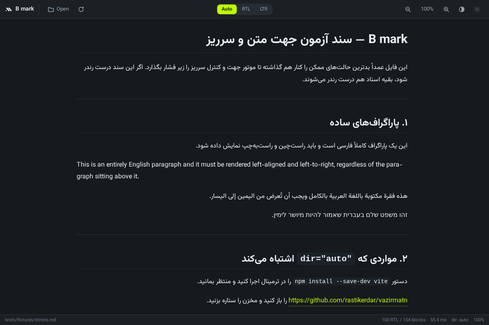
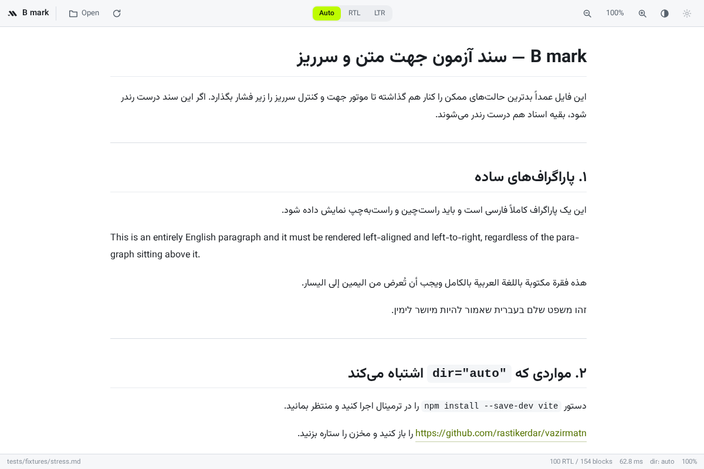
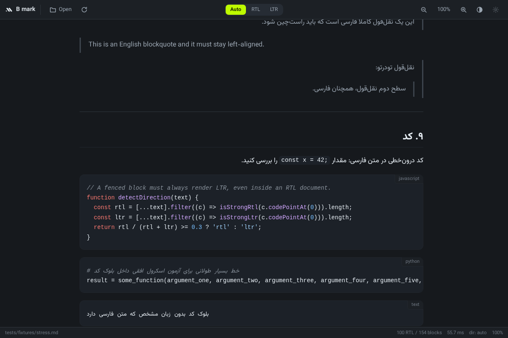
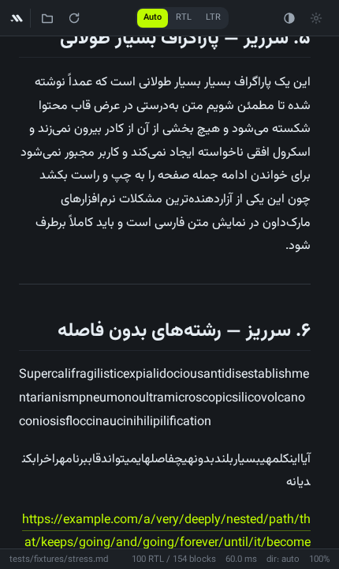
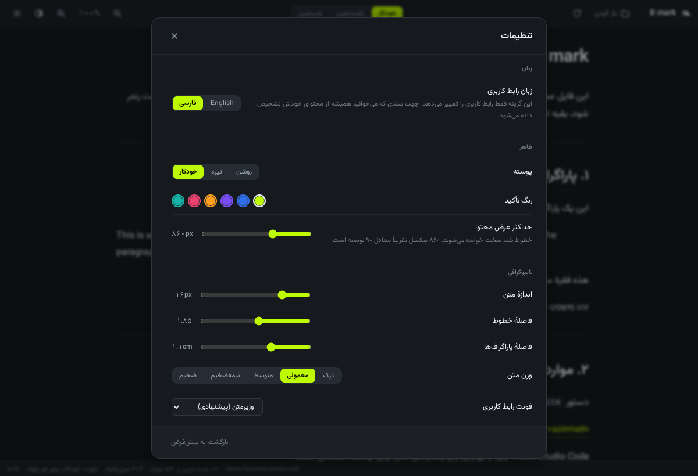
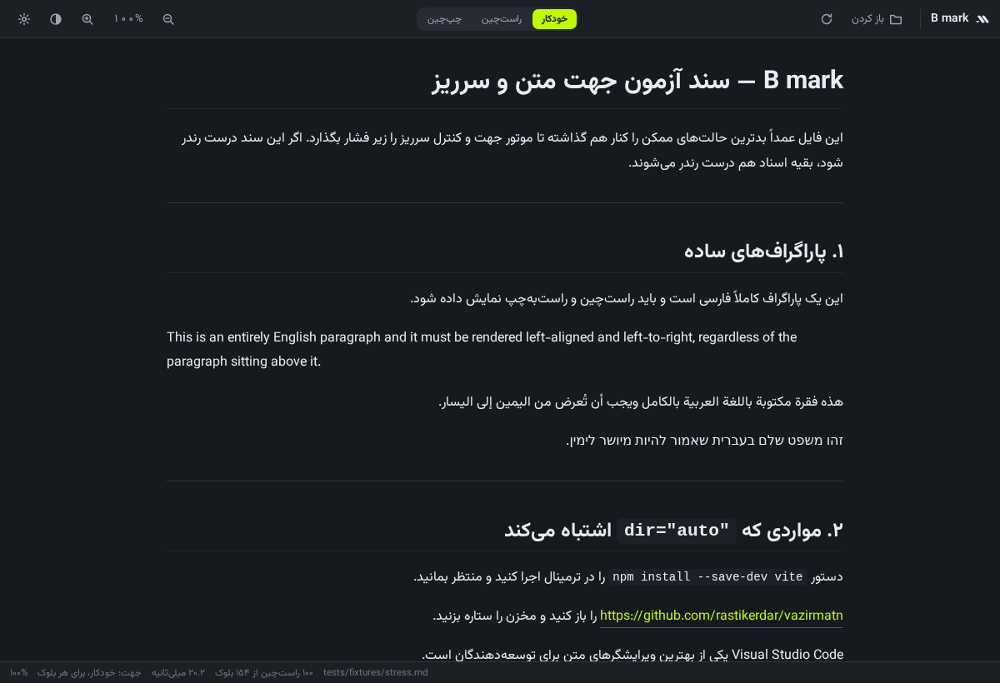
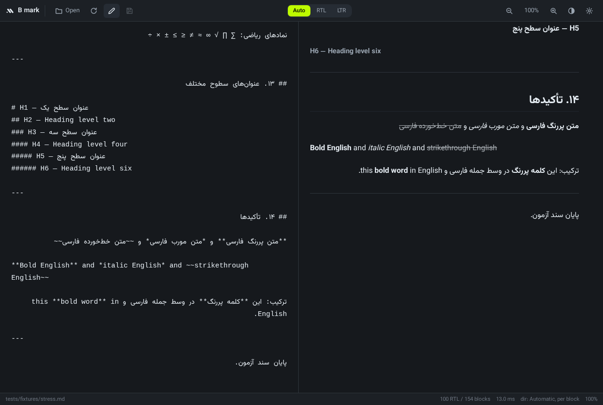
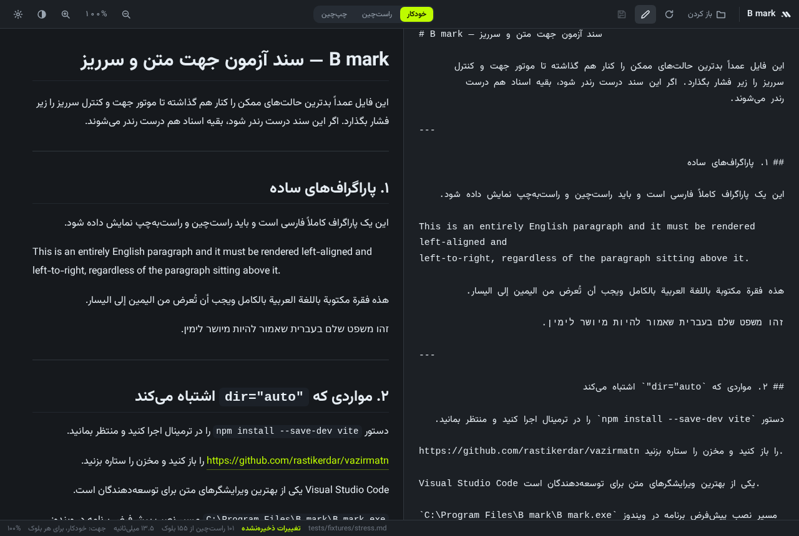

<div align="center">


# B mark

**نمایشگر مارک‌داون سریع و مدرن برای ویندوز — با پشتیبانی فارسی و راست‌به‌چپ به‌عنوان قابلیت اصلی، نه یک وصله.**

[](https://github.com/borodayeh/b-mark/actions/workflows/build-windows.yml)
[](LICENSE)

[English](README.md) · [راهنمای ساخت](BUILD.fa.md) · [راهنمای انتشار](RELEASING.md) · [مشارکت](CONTRIBUTING.fa.md) · [امنیت](SECURITY.fa.md) · [تغییرات](CHANGELOG.md) · [تحویل پروژه](HANDOFF.fa.md)

</div>

---

## چرا یک نمایشگر مارک‌داون دیگر؟

چون همهٔ نمایشگرهای موجود، سند ترکیبی فارسی-انگلیسی را اشتباه نمایش می‌دهند.

روش `dir="auto"` در HTML — که اکثر ادیتورها از جمله MarkText به آن تکیه
می‌کنند — جهت هر بلوک را از **اولین نویسهٔ قوی** آن تعیین می‌کند. این روش
دقیقاً همان‌جا می‌شکند که یک جملهٔ فارسی با یک قطعه کد، یک آدرس اینترنتی یا
نام یک محصول انگلیسی شروع شود — یعنی مدام، در هر متن فنی:

| ورودی | `dir="auto"` | B mark |
|---|---|---|
| `` `npm install` را در ترمینال اجرا کنید. `` | ❌ چپ‌چین | ✅ راست‌چین |
| `https://github.com را باز کنید و فورک کنید.` | ❌ چپ‌چین | ✅ راست‌چین |
| `Visual Studio Code یکی از بهترین ویرایشگرهاست.` | ❌ چپ‌چین | ✅ راست‌چین |
| `فایل را در C:\Users\Ali\note.md ذخیره کنید.` | ❌ چپ‌چین | ✅ راست‌چین |
| `The Persian word for hello is سلام.` | ✅ چپ‌چین | ✅ چپ‌چین |
| `- مورد فارسی` / `- ۱۲۳۴۵` / `- مورد دیگر` | ❌ آیتم وسط چپ‌چین | ✅ همه راست‌چین |
| `> این یک نقل‌قول فارسی است.` | ❌ چپ‌چین | ✅ راست‌چین |

B mark ابتدا قطعه‌های کد، آدرس‌ها، مسیرهای فایل و ایمیل‌ها را از متن حذف
می‌کند، سپس نویسه‌های قوی باقی‌مانده را در هر بلوک **وزن‌دهی و شمارش**
می‌کند، و در پایان بلوک‌های خنثی از همسایه‌های تعیین‌شدهٔ خود ارث می‌برند.
جزئیات کامل در [docs/00-research.md](docs/00-research.md).

## تصاویر

| تم تیره | تم روشن |
|---|---|
|  |  |

| بلوک کد | پنجرهٔ باریک (۴۳۰ پیکسل) |
|---|---|
|  |  |

| تنظیمات فارسی | رابط فارسی — پاراگراف انگلیسی چپ‌چین مانده |
|---|---|
|  |  |

| ویرایشگر دوستونی | ویرایشگر با رابط فارسی |
|---|---|
|  |  |

## قابلیت‌ها

**مارک‌داون**
- CommonMark به‌علاوهٔ GitHub Flavored Markdown: جدول، فهرست کارها،
  خط‌خورده، بلوک کد، لینک خودکار
- **فرانت‌مَتِر YAML** به‌صورت کارت اطلاعات نمایش داده می‌شود، نه اینکه مثل
  بقیهٔ نمایشگرها به‌صورت یک خط افقی و یک تیتر به‌هم‌ریخته خوانده شود — که
  دقیقاً بلایی است که سر خروجی Hugo و Jekyll و Obsidian می‌آید
- پانویس، فهرست تعریف، `==هایلایت==`، `++اضافه++`، `~زیرنویس~`، `^بالانویس^`
- **فرمول ریاضی (KaTeX)** و **نمودار (Mermaid)**، هر دو با بارگذاری تنبل: سندی
  که هیچ‌کدام را ندارد هیچ‌کدام را دانلود نمی‌کند و باندل اصلی ۴۱۲ کیلوبایت می‌ماند
- برجسته‌سازی نحو برای ۲۷ زبان؛ زبان ناشناخته به متن سادهٔ خوانا تبدیل
  می‌شود، نه خطا
- عنوان‌های H1 تا H6 با لنگر داخلی کارآمد، **از جمله عنوان‌های فارسی**
- یونیکد کامل: نیم‌فاصله، ارقام فارسی، گیومهٔ فارسی، ایموجی

**فارسی، عربی، عبری و راست‌به‌چپ**
- جهت متن **در سطح هر بلوک** تعیین می‌شود، نه کل سند
- جدول‌ها و فهرست‌ها با رأی اکثریت سلول‌ها و آیتم‌های خود جهت می‌گیرند، تا
  ترتیب ستون‌ها و سمت بولت‌ها درست باشد
- کد، لینک، کلیدهای صفحه‌کلید و مسیر فایل داخل متن فارسی چپ‌به‌راست و
  ایزوله می‌مانند
- تغییر دستی: خودکار / راست‌به‌چپ / چپ‌به‌راست
- فونت [وزیرمتن](https://github.com/rastikerdar/vazirmatn) در تمام برنامه،
  هر نه وزن، همراه برنامه — بدون نیاز به نصب فونت

**جعبه‌ابزار متن فارسی** — بخشی که هیچ ادیتور دیگری درست انجام نمی‌دهد
- یک دستور همهٔ چیزهایی را که نویسندهٔ فارسی امروز دستی اصلاح می‌کند درست
  می‌کند: تبدیل ي ك ة عربی به ی ک ه، درج نیم‌فاصله در پیشوند می‌ و پسوند ‌ها،
  مرتب کردن فاصله‌های نگارشی، تبدیل `, ; ?` به `، ؛ ؟`
- **کد، آدرس، مسیر فایل، ایمیل و فرمول پیش از اجرای هر قاعده کنار گذاشته
  می‌شوند**، پس `کتاب ها` به `کتاب‌ها` تبدیل می‌شود ولی `some_var ها` داخل یک
  قطعه کد دقیقاً همان‌طور که نوشته شده می‌ماند. اجرای دوباره چیزی را تغییر
  نمی‌دهد
- <kbd>Ctrl</kbd>+<kbd>Shift</kbd>+<kbd>Space</kbd> نیم‌فاصله را در مکان‌نما درج می‌کند
- **کپی با قالب‌بندی** در Word، Outlook یا تلگرام با قالب‌بندی *و* جهت درست
  چسبانده می‌شود — پاراگراف فارسی بدون دست زدن به هیچ تنظیمی راست‌چین می‌رسد

**خواندن**
- **نوار فهرست مطالب** که از عنوان‌های رندرشده ساخته می‌شود و هر ورودی جهت
  مستقل خودش را دارد — عنوان فارسی راست‌چین می‌شود و انگلیسی نه
- **جست‌وجو در سند** با تطبیق باگذشت فارسی: ی/ي، ک/ك، نیم‌فاصله و ارقام
  فارسی همگی یکسان دیده می‌شوند، پس «می خواهم» عبارت «می‌خواهم» را پیدا
  می‌کند و «1234» عبارت «۱۲۳۴» را. هایلایت با CSS Custom Highlight API
  کشیده می‌شود، پس جست‌وجو هرگز به جهت‌هایی که موتور تعیین کرده دست نمی‌زند
- **دکمهٔ کپی** روی هر بلوک کد
- **شمار واژه و زمان مطالعه** در نوار وضعیت، با حذف کد از محاسبه و سرعت
  خواندن کمتر برای متن فارسی و عربی
- **فایل‌های اخیر** در صفحهٔ شروع
- **زبانه‌ها** با `Ctrl+Tab`، `Ctrl+1..9` و بستن با کلیک وسط
- **بازگشایی نشست** — همان اسنادی که باز بودند، بر اساس مسیر و نه با کپی کردن
  فایل‌های شما داخل حافظهٔ مرورگر
- **لایت‌باکس** برای تصویر و نمودار، با بزرگ‌نمایی چرخ ماوس و کشیدن
- **مرور پوشه** — B mark را روی یک پوشهٔ اسناد تنظیم کنید و فایل‌های مارک‌داون
  را از نوار کناری باز کنید، سطح به سطح
- **غلط‌یابی اختیاری** فارسی و انگلیسی با لغت‌نامه‌های Hunspell، چون ویندوز
  لغت‌نامهٔ فارسی ندارد — پیش‌فرض خاموش، چون ساخت لغت‌نامهٔ فارسی حدود
  ۱۷۲ مگابایت حافظه هزینه دارد

**خروجی**
- **ذخیره به‌صورت HTML** — یک فایل کاملاً مستقل با فونت جاسازی‌شده. روی
  دستگاهی که هیچ فونت فارسی ندارد هم درست نمایش داده می‌شود و هنگام باز شدن
  هیچ درخواستی به اینترنت نمی‌فرستد. آدرس تصویرهایی که بلاک کرده‌اید حذف
  می‌شود، نه اینکه داخل فایلی که می‌فرستید بماند
- **ذخیره به‌صورت DOCX** — یک سند واقعی ورد که جهت در آن باقی می‌ماند: هر دو
  نشانهٔ `<w:bidi/>` در سطح پاراگراف و `<w:rtl/>` در سطح نویسه از یک پاسخ
  بلوک‌به‌بلوک گرفته می‌شوند و نام لاتین محصول داخل جملهٔ فارسی از شکل‌دهندهٔ
  پیچیدهٔ ورد دور نگه داشته می‌شود
- **چاپ / ذخیره به‌صورت PDF** با شیوه‌نامهٔ چاپ که از شکستن بلوک کد، جدول و
  تصویر جلوگیری می‌کند و آدرس لینک‌ها را داخل پرانتز چاپ می‌کند

**ویرایش**
- ویرایشگر دوستونی اختیاری: متن مبدأ در یک سو، پیش‌نمایش زنده در سوی دیگر،
  با همگام‌سازی نسبی اسکرول
- ذخیره با <kbd>Ctrl</kbd>+<kbd>S</kbd>؛ نوار وضعیت تغییرات ذخیره‌نشده را
  نشان می‌دهد
- **ذخیرهٔ خودکار اختیاری**، پیش‌فرض خاموش، چند ثانیه بعد از توقف تایپ
- بارگذاری زندهٔ فایل هنگام ویرایش در جای دیگر — مگر آنکه تغییر ذخیره‌نشده
  داشته باشید، که در آن صورت B mark خبر می‌دهد و بازنویسی نمی‌کند

**رابط کاربری**
- **نوار عنوان اختصاصی.** پنجره بدون قاب سیستم است، پس لوگو، نام سند و
  دکمه‌های کوچک‌کردن/بزرگ‌کردن/بستن همگی در یک نوار ۳۲ پیکسلی قرار می‌گیرند
  به‌جای اینکه زیر یک نوار عنوان جداگانهٔ ویندوز بنشینند
- **دوزبانه: فارسی و انگلیسی**، با چرخش کامل پوسته به راست‌چین در حالت
  فارسی — در حالی که سندی که می‌خوانید جهت مستقل هر بلوک خودش را حفظ
  می‌کند. زبان رابط هرگز جهت سند را تعیین نمی‌کند.
- **تم چهارگانهٔ محتوا** — پیش‌فرض، دانشگاهی، کتاب، فشرده — تیمارهای
  حروف‌نگاری سند که به خروجی HTML و چاپ هم منتقل می‌شوند
- صفحهٔ تنظیمات با ۳۰ گزینه که زنده اعمال و ذخیره می‌شوند: پوسته، رنگ
  تأکید، عرض محتوا، اندازهٔ متن، فاصلهٔ خطوط، فاصلهٔ پاراگراف، وزن متن،
  سه انتخاب فونت مستقل، حالت جهت، و کلیدهای محتوا و امنیت
- منوی راست‌کلیک که فقط کارهای واقعاً مؤثر را پیشنهاد می‌دهد
- تم روشن، تیره و خودکار بر اساس تنظیمات ویندوز
- بزرگ‌نمایی ۶۰ تا ۲۴۰ درصد با میانبر صفحه‌کلید
- هیچ چیز از قاب بیرون نمی‌زند: پاراگراف بلند می‌شکند، آدرس بلند تقسیم
  می‌شود، جدول عریض و کد بلند **داخل کادر خودشان** اسکرول می‌شوند، تصاویر
  به عرض ستون محدود می‌شوند، و پنجره هرگز افقی اسکرول نمی‌شود

**اعتماد**
- بدون تله‌متری، بدون آنالیتیکس. تنها درخواست شبکه‌ای که برنامه می‌تواند
  بفرستد بررسی به‌روزرسانی است، و آن هم **فقط وقتی روی «بررسی به‌روزرسانی»
  کلیک کنید** اجرا می‌شود — نه تایمری هست و نه بررسی در شروع برنامه
- HTML خام به‌طور پیش‌فرض escape می‌شود؛ در صورت فعال‌سازی با DOMPurify
  پاک‌سازی می‌شود
- لینک‌ها هرگز خود برنامه را جابه‌جا نمی‌کنند — با کلیک شما در مرورگرتان
  باز می‌شوند
- مجوز MIT، فهرست کامل وابستگی‌ها در [THIRD-PARTY.md](THIRD-PARTY.md)

## نصب

### نسخهٔ Portable (پیشنهادی)

فایل `B mark 0.1.2 Portable.exe` را از [Releases](../../releases) دانلود و دوبار کلیک کنید.

> حجم نسخهٔ فعلی **۸٫۲ مگابایت** است، معماری x64، با CRT به‌صورت استاتیک
> لینک‌شده، و کل فرانت‌اند و هر نه وزن فونت وزیرمتن داخلش جاسازی شده. فقط ۱۳
> کتابخانهٔ استاندارد ویندوز را فراخوانی می‌کند و به Visual C++ Redistributable
> نیاز ندارد. برای بررسی فایل دانلودی از `scripts/verify-exe.py` استفاده کنید.

- بدون نصب، بدون Administrator، بدون پنجرهٔ UAC
- هیچ چیزی در `Program Files` یا رجیستری سراسری نوشته نمی‌شود
- تنظیمات در `%AppData%\app.bmark.viewer\settings.json` ذخیره می‌شود
- از روی فلش یا هر پوشه‌ای، حتی مسیرهای دارای فاصله، اجرا می‌شود

### نصب‌کنندهٔ تک‌کاربره

فایل `B mark 0.1.2 setup.exe` (۵٫۲ مگابایت) — دوزبانه، فارسی و انگلیسی.

| | |
|---|---|
| محل نصب | `%LOCALAPPDATA%\Programs\B mark` |
| دسترسی Administrator | **هرگز خواسته نمی‌شود** — بدون پنجرهٔ UAC |
| رجیستری | فقط `HKCU`؛ هیچ چیز در `HKLM` |
| اضافه می‌کند | میانبر منوی استارت، میانبر دسکتاپ (اختیاری)، ورودی Add/Remove Programs |
| ثبت پسوند | `.md`، `.markdown`، `.mdown`، `.mkd`، `.mdwn`، `.mdtxt` |
| حذف نصب | تنظیمات ← Apps، یا میانبر منوی استارت. هر فایل و کلید رجیستری‌ای که ساخته را پاک می‌کند |

**دربارهٔ باز شدن خودکار فایل‌های مارک‌داون.** از ویندوز ۸ به بعد، هیچ
نصب‌کننده‌ای نمی‌تواند بی‌سروصدا خودش را به‌عنوان برنامهٔ پیش‌فرض یک پسوند
جا بزند — مایکروسافت عمداً این تصمیم را به کاربر سپرده، و نرم‌افزاری که
بخواهد به‌زور این کار را بکند یا خراب است یا رفتار بدافزار دارد. پس
نصب‌کننده، B mark را به‌عنوان یک handler ثبت می‌کند و آن را در **Open with**
و در **تنظیمات ← Apps ← Default apps** قرار می‌دهد. اولین باری که روی یک
فایل `.md` دوبار کلیک کنید، ویندوز از شما می‌پرسد؛ B mark را انتخاب و گزینهٔ
«Always use this app» را تیک بزنید. از آن به بعد خودکار باز می‌شود.

اسکریپت نصب‌کننده [`installer/b-mark.nsi`](installer/b-mark.nsi) است —
دست‌نویس، نه تولیدشده، تا هر نوشتنی که در رجیستری انجام می‌دهد در یک فایل
خوانا قابل دیدن باشد.

تنظیمات شما در `%AppData%\app.bmark.viewer` هنگام حذف نصب **باقی می‌ماند**،
عمداً: حذف یک برنامه نباید بی‌سروصدا پیکربندی‌ای را که شاید بعداً بخواهید
نابود کند. برای پاک‌سازی کامل، آن پوشه را دستی حذف کنید.

### ⚠️ نیاز به WebView2 — این بخش را حتماً بخوانید

B mark با Tauri ساخته شده، پس به‌جای همراه‌بردن موتور مرورگر خودش، از
**Microsoft Edge WebView2 Runtime** استفاده می‌کند. همین باعث می‌شود حجم
دانلود حدود ۸ مگابایت بماند نه ۱۵۰ مگابایت، و دقیقاً به همین دلیل متن فارسی
درست شکل می‌گیرد — WebView2 پیاده‌سازی HarfBuzz و الگوریتم دوجهتهٔ یونیکد
کرومیوم را با خود می‌آورد.

- WebView2 روی **ویندوز ۱۱ از پیش نصب است** و روی ویندوز ۱۰ به‌روز نیز.
- اگر نصب نباشد، B mark پیامی روشن به فارسی و انگلیسی با لینک نصب‌کنندهٔ
  رسمی مایکروسافت نمایش می‌دهد.
- **B mark هرگز چیزی را مخفیانه دانلود یا نصب نمی‌کند.**

پس: نسخهٔ Portable واقعاً یک فایل `B mark.exe` است، اما یک باینری
بدون‌وابستگی **نیست**. ادعای خلاف آن را نمی‌کنیم.

## میانبرهای صفحه‌کلید

| میانبر | عملکرد |
|---|---|
| <kbd>Ctrl</kbd>+<kbd>O</kbd> | باز کردن فایل |
| <kbd>Ctrl</kbd>+<kbd>R</kbd> | بارگذاری مجدد |
| <kbd>Ctrl</kbd>+<kbd>,</kbd> | تنظیمات |
| <kbd>Ctrl</kbd>+<kbd>E</kbd> | نمایش/بستن ویرایشگر |
| <kbd>Ctrl</kbd>+<kbd>S</kbd> | ذخیره |
| <kbd>Ctrl</kbd>+<kbd>F</kbd> | جست‌وجو در سند |
| <kbd>Ctrl</kbd>+<kbd>Shift</kbd>+<kbd>O</kbd> | فهرست مطالب |
| <kbd>Ctrl</kbd>+<kbd>P</kbd> | چاپ / ذخیره به‌صورت PDF |
| <kbd>Ctrl</kbd>+<kbd>Shift</kbd>+<kbd>P</kbd> | اصلاح متن فارسی |
| <kbd>Ctrl</kbd>+<kbd>Shift</kbd>+<kbd>Space</kbd> | درج نیم‌فاصله |
| <kbd>Ctrl</kbd>+<kbd>Shift</kbd>+<kbd>C</kbd> | کپی با قالب‌بندی |
| <kbd>Ctrl</kbd>+<kbd>Tab</kbd> · <kbd>Ctrl</kbd>+<kbd>1..9</kbd> | تغییر سند |
| <kbd>Ctrl</kbd>+<kbd>W</kbd> | بستن زبانه |
| <kbd>Ctrl</kbd>+<kbd>+</kbd> / <kbd>-</kbd> | بزرگ‌نمایی / کوچک‌نمایی |
| <kbd>Ctrl</kbd>+<kbd>0</kbd> | بازنشانی بزرگ‌نمایی |
| <kbd>F11</kbd> | تمام‌صفحه |
| <kbd>Esc</kbd> | بستن پنجره / خروج از تمام‌صفحه |

## ساخت از سورس

راهنمای کامل در **[BUILD.fa.md](BUILD.fa.md)**. خلاصه:

```powershell
npm ci
npm run tauri:dev              # حالت توسعه
.\scripts\build-portable.ps1   # خروجی: release/B mark.exe + SHA256SUMS.txt
```

نیازمند Node.js نسخه ۲۰ به بالا، Rust با زنجیرهٔ MSVC، و Python 3 (فقط برای
بازتولید آیکون‌ها از فایل‌های SVG).

## امنیت و هشدار اشتباه آنتی‌ویروس

خلاصه — شرح کامل در **[SECURITY.fa.md](SECURITY.fa.md)**:

- سورس کاملاً باز و قابل بررسی است. هیچ Obfuscation، هیچ Packing، هیچ اجرای
  مخفی پروسه، هیچ فراخوانی PowerShell یا `cmd.exe`، هیچ تله‌متری و هیچ کد
  شبکه‌ای وجود ندارد.
- دسترسی به فایل محدود به فایل‌هایی است که خودتان باز می‌کنید.
- فایل‌های منتشرشده با هش SHA-256 همراه‌اند.
- **نسخه‌های فعلی امضای دیجیتال ندارند.** فایل اجرایی بدون امضا می‌تواند
  هشدار SmartScreen ویندوز یا heuristic آنتی‌ویروس‌ها را فعال کند.
- هیچ‌کس نمی‌تواند تضمین کند یک فایل اجرایی هرگز توسط هیچ آنتی‌ویروسی
  علامت‌گذاری نمی‌شود، و **ما چنین ادعایی نمی‌کنیم.** کاری که می‌توانیم
  بکنیم این است که مثل یک نرم‌افزار دسکتاپ معمولی رفتار کنیم و قابل بازرسی
  باشیم — که موارد بالا دقیقاً برای همین است. می‌توانید هر نسخه را در
  [VirusTotal](https://www.virustotal.com/) بررسی کنید.

## سازنده

**B mark را مسعود برودایه با کمک Arena ساخته است.**

ساختش هزینه‌ای نداشت، پس رایگان هم منتشر می‌شود: برنامه رایگان است، کدش باز
است، و [مجوز MIT](LICENSE) به هر کسی اجازه می‌دهد آن را استفاده، کپی، تغییر و
بازنشر کند — حتی به‌صورت تجاری — به شرط باقی ماندن متن حق مؤلف. نه نسخهٔ
پولی دارد، نه تله‌متری، نه حساب کاربری، و هیچ داده‌ای هیچ‌جا فرستاده نمی‌شود.

## منابع الهام

هر پروژهٔ زیر فقط برای ایده‌های طراحی بررسی شده است. **هیچ کدی کپی نشده.**
نسخهٔ بایگانی‌شدهٔ فایل‌های دقیقی که مطالعه شدند در `docs/references/` است.

| پروژه | چه چیزی از آن آموختیم |
|---|---|
| [MarkText](https://github.com/marktext/marktext) (MIT) | ساختار نوار ابزار و توکن‌های تم — و مدیریت `dir` در سطح سند، که دقیقاً همان محدودیتی است که موتور per-block ما برای رفعش ساخته شد |
| [Zettlr](https://github.com/Zettlr/Zettlr) (GPL-3.0) | سازماندهی تنظیمات و چیدمان i18n مبتنی بر JSON. هیچ چیز کپی نشد — GPL-3.0 با مجوز MIT ما ناسازگار است |
| [Obsidian](https://obsidian.md) (اختصاصی) | فقط الگوهای تجربهٔ کاربری. Obsidian **متن‌باز نیست** و B mark هیچ وابستگی به آن ندارد |
| [مثال File Association تائوری](https://github.com/tauri-apps/tauri/tree/dev/examples/file-associations) | روش مدیریت آرگومان خط فرمان و ثبت پسوند فایل در ویندوز |

فونت و کتابخانه‌ها: [وزیرمتن](https://github.com/rastikerdar/vazirmatn)
(SIL OFL 1.1)، [markdown-it](https://github.com/markdown-it/markdown-it) (MIT)،
[DOMPurify](https://github.com/cure53/DOMPurify) (Apache-2.0 / MPL-2.0)،
[highlight.js](https://github.com/highlightjs/highlight.js) (BSD-3-Clause)،
[Tauri](https://github.com/tauri-apps/tauri) (MIT / Apache-2.0).
فهرست کامل و متن مجوزها: [THIRD-PARTY.md](THIRD-PARTY.md) و `docs/licenses/`.

## گزارش اشکال

یک Issue باز کنید و این‌ها را بنویسید: متن مارک‌داونی که مشکل را بازتولید
می‌کند، تصویر، نسخهٔ ویندوز، و اینکه از نسخهٔ Portable استفاده کرده‌اید یا
نصب‌کننده. **اشکالات مربوط به جهت متن بالاترین اولویت را دارند** — لطفاً
متن دقیق منبع را کپی کنید.

## نقشهٔ راه

- [x] موتور جهت متن در سطح بلوک
- [x] رندر GFM، پاک‌سازی امنیتی، برجسته‌سازی نحو
- [x] تم روشن/تیره/خودکار، فونت وزیرمتن، مهار سرریز
- [x] هویت بصری، آیکون‌ها، خط لولهٔ ساخت Portable
- [x] رابط کاربری دوزبانه (فارسی/انگلیسی) با کلید تغییر زبان
- [x] صفحهٔ تنظیمات با ذخیره‌سازی
- [x] باز کردن فایل بومی، کشیدن و رها کردن، ثبت پسوند، بارگذاری زنده
- [x] ویرایشگر دوستونی اختیاری با قابلیت ذخیره
- [x] خروجی HTML و PDF
- [x] فهرست مطالب، جست‌وجو در سند، آمار مطالعه
- [x] خروجی DOCX با جهتی که در ورد باقی می‌ماند
- [x] غلط‌یابی فارسی و انگلیسی (اختیاری)
- [x] تم‌های محتوا، مرور پوشه، زبانه‌ها و بازگشایی نشست
- [ ] امضای دیجیتال کد

## مجوز

[MIT](LICENSE) — حق مؤلف © ۲۰۲۶ مسعود برودایه. فونت وزیرمتن جداگانه تحت
[مجوز SIL Open Font 1.1](assets/fonts/Vazirmatn-OFL.txt) منتشر شده است.
