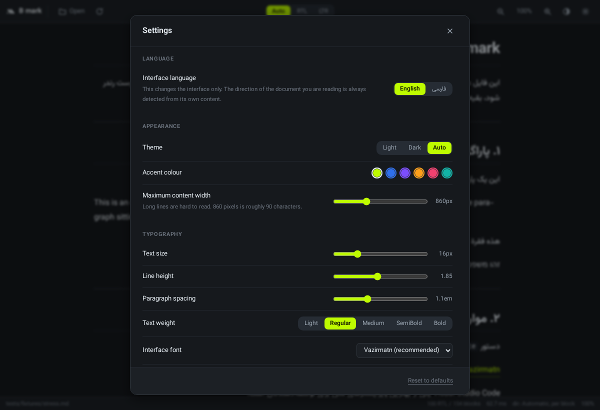

<div align="center">


# B mark

**A fast, modern Markdown viewer for Windows — with Persian and RTL as a first-class feature, not an afterthought.**

[](https://github.com/borodayeh/b-mark/actions/workflows/build-windows.yml)
[](LICENSE)

[فارسی](README.fa.md) · [Build guide](BUILD.md) · [Releasing](RELEASING.md) · [Contributing](CONTRIBUTING.md) · [Security](SECURITY.md) · [Changelog](CHANGELOG.md) · [Project handoff](HANDOFF.md)

</div>

---

## Why another Markdown viewer

Because every existing one gets mixed Persian/English documents wrong.

The HTML `dir="auto"` heuristic — which is what most editors rely on, MarkText
included — picks the direction of a block from its **first strong character**.
That breaks the moment a Persian sentence starts with a code span, a URL or an
English product name, which in technical writing is constantly:

| Source | `dir="auto"` | B mark |
|---|---|---|
| `` `npm install` را در ترمینال اجرا کنید. `` | ❌ LTR | ✅ RTL |
| `https://github.com را باز کنید و فورک کنید.` | ❌ LTR | ✅ RTL |
| `Visual Studio Code یکی از بهترین ویرایشگرهاست.` | ❌ LTR | ✅ RTL |
| `فایل را در C:\Users\Ali\note.md ذخیره کنید.` | ❌ LTR | ✅ RTL |
| `The Persian word for hello is سلام.` | ✅ LTR | ✅ LTR |
| `- مورد فارسی` / `- ۱۲۳۴۵` / `- مورد دیگر` | ❌ middle item LTR | ✅ all RTL |
| `> این یک نقل‌قول فارسی است.` | ❌ LTR | ✅ RTL |

B mark strips code spans, URLs, file paths and e-mail addresses out of the
text first, then **weighs** the remaining strong characters per block, then
lets neutral blocks inherit from their resolved neighbours. Details in
[docs/00-research.md](docs/00-research.md).

## Screenshots

| Dark | Light |
|---|---|
|  |  |

| Code blocks | Narrow window (430 px) |
|---|---|
|  |  |

| Settings | Persian interface — note the English paragraph stays LTR |
|---|---|
|  |  |

| Split editor | Split editor, Persian interface |
|---|---|
|  |  |

## Features

**Markdown**
- CommonMark plus GitHub Flavored Markdown: tables, task lists, strikethrough,
  fenced code, autolinks
- **YAML front matter** shown as a metadata card rather than misread as a rule
  and a mangled heading — which is what every other viewer does to the output
  of Hugo, Jekyll and Obsidian
- Footnotes, definition lists, `==mark==`, `++ins++`, `~sub~`, `^sup^`
- **Math (KaTeX)** and **diagrams (Mermaid)**, both loaded lazily: a document
  with neither downloads neither, and the main bundle stays at 412 KB
- Syntax highlighting for 27 languages; unknown languages degrade to readable
  plain text instead of failing
- Headings H1–H6 with working internal anchors, **including Persian headings**
- Full Unicode: ZWNJ (نیم‌فاصله), Persian digits, Persian quotation marks, emoji

**Persian, Arabic, Hebrew and RTL**
- Direction resolved **per block**, not per document
- Tables and lists orient by a majority vote of their cells/items, so columns
  and bullets land on the correct side
- Code, links, `kbd` and file paths stay LTR and bidi-isolated inside RTL prose
- Manual override: Auto / RTL / LTR
- [Vazirmatn](https://github.com/rastikerdar/vazirmatn) everywhere, all nine
  weights, bundled — no font installation required

**Persian text tooling** — the part no other editor does properly
- One command fixes what Persian writers currently fix by hand: Arabic ي ك ة
  normalised to Persian ی ک ه, ZWNJ inserted in می‌ prefixes and ‌ها suffixes,
  spacing tightened around punctuation, `, ; ?` converted to `، ؛ ؟`
- **Code, URLs, file paths, e-mail addresses and formulas are masked out before
  any rule runs**, so `کتاب ها` becomes `کتاب‌ها` while `some_var ها` inside a
  code span is left exactly as written. The transform is idempotent
- <kbd>Ctrl</kbd>+<kbd>Shift</kbd>+<kbd>Space</kbd> inserts a ZWNJ at the caret
- **Copy as formatted text** pastes into Word, Outlook or Telegram with the
  formatting *and* the per-block direction intact — a Persian paragraph
  arrives right-aligned without touching a paragraph setting

**Reading**
- **Outline sidebar** built from the rendered headings, each entry carrying its
  own direction — a Persian heading right-aligns, an English one does not
- **Find in document** with loose Persian matching: ی/ي, ک/ك, ZWNJ and Persian
  digits all match, so searching "می خواهم" finds "می‌خواهم" and "1234" finds
  "۱۲۳۴". Highlights are painted with the CSS Custom Highlight API, so a search
  never disturbs the direction attributes the engine just resolved
- **Copy button** on every code block
- **Word count and reading time** in the status bar, with code excluded from
  the estimate and a slower words-per-minute figure for Arabic-script prose
- **Recent files** on the start screen
- **Tabs** with `Ctrl+Tab`, `Ctrl+1..9` and middle-click close
- **Session restore** — reopens what you had open, by path rather than by
  copying your documents into browser storage
- **Lightbox** for images and diagrams, with wheel zoom and drag
- **Folder browsing** — point B mark at a docs directory and open Markdown
  files from the sidebar, one level at a time
- Optional **spell checking** for Persian and English, built on Hunspell
  dictionaries because Windows ships no Persian dictionary — off by default,
  since the Persian dictionary costs ~172 MB of heap to build

**Export**
- **Save as HTML** — one self-contained file with the fonts embedded as data
  URIs. It renders Persian correctly on a machine with no Persian font, and it
  makes no network request when the recipient opens it. The URL of any image
  you chose to block is stripped rather than carried into a file you might send
- **Save as DOCX** — a real Word document in which direction survives: both
  the paragraph-level `<w:bidi/>` and the character-level `<w:rtl/>` are set
  from the same per-block answer, and a Latin product name inside a Persian
  sentence is kept out of Word's complex-script shaper
- **Print / Save as PDF** with a print stylesheet that avoids breaking inside
  code blocks, tables and images, and prints link targets in parentheses

**Editing**
- Optional split editor: source on one side, live preview on the other, with
  proportional scroll sync
- Save with <kbd>Ctrl</kbd>+<kbd>S</kbd>; the status bar shows unsaved changes
- Optional **auto-save**, off by default, firing a few seconds after typing stops
- Live reload when the file is edited elsewhere — unless you have unsaved work,
  in which case B mark tells you rather than overwriting it

**Interface**
- **Its own title bar.** The window is frameless, so the brand, the document
  name and the minimise/maximise/close buttons share one 32-pixel strip instead
  of sitting under a separate OS caption bar
- **Bilingual: English and Persian**, with the chrome flipping to RTL for
  Persian — while the document you are reading keeps its own per-block
  direction. The interface language never dictates the document's direction.
- **Four content themes** — default, academic, book, compact — typographic
  treatments of the document that travel into the HTML export and the print
- Settings panel with 30 options, applied live and persisted: theme, accent
  colour, content width, text size, line height, paragraph spacing, font
  weight, three independent font choices, direction mode, and the content
  and security switches below
- Right-click menu that only offers actions which will actually do something
- Light, Dark, and Auto following the Windows setting
- Zoom 60–240 % with keyboard shortcuts
- Nothing ever escapes the frame: long paragraphs wrap, long URLs break, wide
  tables and long code scroll **inside their own box**, images cap at the
  column width, and the window never scrolls sideways

**Trust**
- No telemetry, no analytics. The only network request the app can make is an
  update check, and it fires **only when you click "Check for update"** —
  there is no timer and no startup check
- Raw HTML is escaped by default; when enabled it is sanitised with DOMPurify
- Links never navigate the app — they open in your browser, on your click
- MIT licensed, every dependency listed in [THIRD-PARTY.md](THIRD-PARTY.md)

## Install

### Portable (recommended)

Download `B mark 0.1.2 Portable.exe` from [Releases](../../releases) and double-click it.

> The current build is **8.2 MB**, x64, statically linked against the CRT, with
> the entire frontend and all nine Vazirmatn weights baked in. It imports only
> 13 standard Windows DLLs and needs no Visual C++ Redistributable. Verify a
> download with `scripts/verify-exe.py`.

- No installation, no Administrator, no UAC prompt
- Nothing written to `Program Files` or the global registry
- Settings live in `%AppData%\app.bmark.viewer\settings.json`
- Runs from a USB stick or any folder, including paths containing spaces

### Per-user installer

`B mark 0.1.2 setup.exe` (5.2 MB) — bilingual, English and Persian.

| | |
|---|---|
| Installs to | `%LOCALAPPDATA%\Programs\B mark` |
| Administrator | **never asked for** — no UAC prompt |
| Registry | `HKCU` only; nothing in `HKLM` |
| Adds | Start Menu entry, optional desktop shortcut, Add/Remove Programs entry |
| Associates | `.md`, `.markdown`, `.mdown`, `.mkd`, `.mdwn`, `.mdtxt` |
| Uninstall | Settings → Apps, or the Start Menu shortcut. Removes every file and registry key it created |

**About opening Markdown files automatically.** Since Windows 8, an installer
cannot silently make itself the default handler for a file type — Microsoft
moved that decision to the user deliberately, and software that tries to force
it is either broken or malware-shaped. So the installer registers B mark as a
handler and puts it in **Open with** and in **Settings → Apps → Default apps**.
The first time you double-click a `.md` file Windows asks you to choose; pick
B mark and tick "Always use this app". From then on it opens automatically.

The installer script is [`installer/b-mark.nsi`](installer/b-mark.nsi) —
hand-written, not generated, so every registry write it makes is visible in
one readable file.

Your settings in `%AppData%\app.bmark.viewer` are **kept** on uninstall, on
purpose: removing an app should not silently destroy configuration you may
want back. Delete that folder by hand for a clean slate.

### ⚠️ WebView2 requirement — read this

B mark is built with Tauri, so it renders through the **Microsoft Edge
WebView2 Runtime** rather than shipping its own browser engine. That is what
keeps the download around 8 MB instead of 150 MB, and it is why Persian text
shapes correctly — WebView2 brings Chromium's HarfBuzz and Unicode
bidirectional implementation with it.

- WebView2 is **pre-installed on Windows 11** and on current Windows 10.
- If it is missing, B mark shows a clear message in Persian and English with a
  link to Microsoft's official installer.
- **B mark never downloads or installs anything silently.**

So: the portable build is a single `B mark.exe`, but it is *not* a
zero-dependency binary. We are not going to claim otherwise.

## Keyboard shortcuts

| Shortcut | Action |
|---|---|
| <kbd>Ctrl</kbd>+<kbd>O</kbd> | Open file |
| <kbd>Ctrl</kbd>+<kbd>R</kbd> | Reload |
| <kbd>Ctrl</kbd>+<kbd>,</kbd> | Settings |
| <kbd>Ctrl</kbd>+<kbd>E</kbd> | Toggle the editor |
| <kbd>Ctrl</kbd>+<kbd>S</kbd> | Save |
| <kbd>Ctrl</kbd>+<kbd>F</kbd> | Find in document |
| <kbd>Ctrl</kbd>+<kbd>Shift</kbd>+<kbd>O</kbd> | Outline |
| <kbd>Ctrl</kbd>+<kbd>P</kbd> | Print / save as PDF |
| <kbd>Ctrl</kbd>+<kbd>Shift</kbd>+<kbd>P</kbd> | Fix Persian text |
| <kbd>Ctrl</kbd>+<kbd>Shift</kbd>+<kbd>Space</kbd> | Insert ZWNJ (نیم‌فاصله) |
| <kbd>Ctrl</kbd>+<kbd>Shift</kbd>+<kbd>C</kbd> | Copy as formatted text |
| <kbd>Ctrl</kbd>+<kbd>Tab</kbd> · <kbd>Ctrl</kbd>+<kbd>1..9</kbd> | Switch document |
| <kbd>Ctrl</kbd>+<kbd>W</kbd> | Close tab |
| <kbd>Ctrl</kbd>+<kbd>+</kbd> / <kbd>-</kbd> | Zoom in / out |
| <kbd>Ctrl</kbd>+<kbd>0</kbd> | Reset zoom |
| <kbd>F11</kbd> | Full screen |
| <kbd>Esc</kbd> | Close dialog / leave full screen |

## Build from source

See **[BUILD.md](BUILD.md)** for the full guide. The short version:

```powershell
npm ci
npm run tauri:dev              # development
.\scripts\build-portable.ps1   # release/B mark.exe + SHA256SUMS.txt
```

Requires Node.js 20+, Rust with the MSVC toolchain, and Python 3 (only to
regenerate icons from the SVG masters).

## Security and antivirus false positives

Short version, expanded in **[SECURITY.md](SECURITY.md)**:

- The source is fully open and auditable. There is no obfuscation, no packing,
  no hidden process spawning, no PowerShell or `cmd.exe` invocation, no
  telemetry, and no network code.
- File access is limited to files you explicitly open.
- Release binaries are published with SHA-256 checksums.
- **Current releases are not code-signed.** Unsigned executables can trigger
  Windows SmartScreen warnings and antivirus heuristics.
- No one can guarantee that an executable will never be flagged by any
  antivirus, and **we do not make that claim.** What we can do is behave like
  an ordinary desktop application and be inspectable — which is what the
  points above are for. You are welcome to check any release on
  [VirusTotal](https://www.virustotal.com/).

## Who made this

**B mark was built by Masoud Borodayeh with help from Arena.**

It cost nothing to make, so it is given away for nothing: the app is free, the
source is open, and the [MIT licence](LICENSE) lets anyone use, copy, change
and redistribute it — including commercially — as long as the copyright notice
stays. There is no paid tier, no telemetry, no account, and nothing is ever
sent anywhere.

## Credits and inspiration

Every project below was studied for design ideas only. **No code was copied.**
Archived copies of the specific files reviewed are in `docs/references/`.

| Project | What we learned from it |
|---|---|
| [MarkText](https://github.com/marktext/marktext) (MIT) | Toolbar and theme-token structure — and its document-level `dir` handling, which is precisely the limitation B mark's per-block engine exists to fix |
| [Zettlr](https://github.com/Zettlr/Zettlr) (GPL-3.0) | Settings organisation and JSON-file i18n layout. Nothing copied — GPL-3.0 is incompatible with our MIT licence |
| [Obsidian](https://obsidian.md) (proprietary) | UX patterns only. Obsidian is **not** open source and B mark is unaffiliated |
| [Tauri file-associations example](https://github.com/tauri-apps/tauri/tree/dev/examples/file-associations) | Approach to CLI arguments and Windows file associations |

Fonts and libraries: [Vazirmatn](https://github.com/rastikerdar/vazirmatn)
(SIL OFL 1.1), [markdown-it](https://github.com/markdown-it/markdown-it) (MIT),
[DOMPurify](https://github.com/cure53/DOMPurify) (Apache-2.0 / MPL-2.0),
[highlight.js](https://github.com/highlightjs/highlight.js) (BSD-3-Clause),
[Tauri](https://github.com/tauri-apps/tauri) (MIT / Apache-2.0).
Full list and licence texts: [THIRD-PARTY.md](THIRD-PARTY.md) and
`docs/licenses/`.

## Reporting bugs

Open an issue with the Markdown that reproduces it, a screenshot, your Windows
version, and whether you used the portable or installer build. Direction bugs
are the highest priority — please paste the exact source text.

## Roadmap

- [x] Per-block direction engine
- [x] GFM rendering, sanitisation, syntax highlighting
- [x] Light / Dark / Auto themes, Vazirmatn, overflow containment
- [x] Brand identity, icons, portable build pipeline
- [x] Bilingual interface (fa/en) with a language switch
- [x] Settings page with persistence
- [x] Native file open, drag & drop, file association, live reload
- [x] Optional split editor with save
- [x] Export to HTML and PDF
- [x] Outline, find in document, reading statistics
- [x] DOCX export with direction that survives Word
- [x] Persian and English spell checking (opt-in)
- [x] Content themes, folder browsing, tabs and session restore
- [ ] Code signing

## Licence

[MIT](LICENSE) — Copyright (c) 2026 Masoud Borodayeh. The Vazirmatn font is licensed separately under the
[SIL Open Font License 1.1](assets/fonts/Vazirmatn-OFL.txt).
