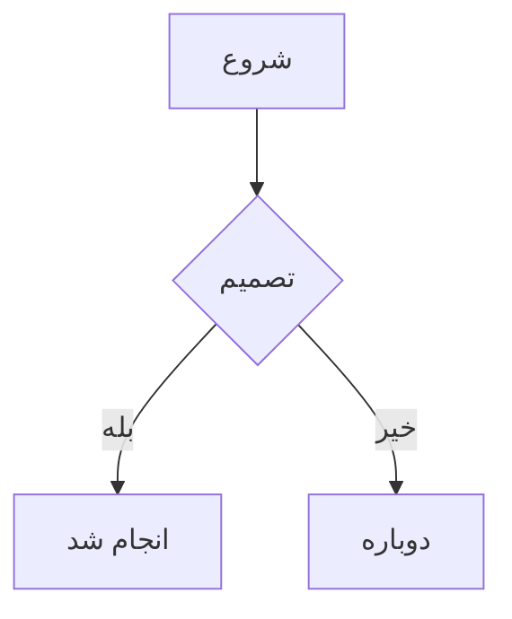

# B mark — سند آزمون جهت متن و سرریز

این فایل عمداً بدترین حالت‌های ممکن را کنار هم گذاشته تا موتور جهت و کنترل
سرریز را زیر فشار بگذارد. اگر این سند درست رندر شود، بقیه اسناد هم درست
رندر می‌شوند.

---

## ۱. پاراگراف‌های ساده

این یک پاراگراف کاملاً فارسی است و باید راست‌چین و راست‌به‌چپ نمایش داده شود.

This is an entirely English paragraph and it must be rendered left-aligned and
left-to-right, regardless of the paragraph sitting above it.

هذه فقرة مكتوبة باللغة العربية بالكامل ويجب أن تُعرض من اليمين إلى اليسار.

זהו משפט שלם בעברית שאמור להיות מיושר לימין.

---

## ۲. مواردی که `dir="auto"` اشتباه می‌کند

دستور `npm install --save-dev vite` را در ترمینال اجرا کنید و منتظر بمانید.

https://github.com/rastikerdar/vazirmatn را باز کنید و مخزن را ستاره بزنید.

Visual Studio Code یکی از بهترین ویرایشگرهای متن برای توسعه‌دهندگان است.

`C:\Program Files\B mark\B mark.exe` مسیر نصب پیش‌فرض برنامه در ویندوز است.

The Persian word for "hello" is سلام, and it is used everywhere in Iran.

---

## ۳. اعداد و نویسه‌های خنثی

در سال 2026 حدود 1,250 نفر در این نظرسنجی شرکت کردند.

قیمت محصول ۱٬۲۵۰٬۰۰۰ تومان است و شامل ۹٪ مالیات بر ارزش افزوده می‌شود.

The build produced ۱۲۳ artifacts, which is unusual for an English document.

۱۲۳۴۵۶۷۸۹۰

---

## ۴. نیم‌فاصله و نگارش فارسی

می‌خواهم برنامه‌نویسی یاد بگیرم و نرم‌افزارهای کاربردی بسازم.

او گفت: «سلام، حال شما چطور است؟» و سپس رفت — بدون خداحافظی…

کتاب‌ها، دفترچه‌ها و یادداشت‌های دست‌نویسم را جمع‌آوری کردم.

آیا می‌دانستید که حرف «ی» فارسی با «ي» عربی متفاوت است؟ همچنین «ک» و «ك».

---

## ۵. سرریز — پاراگراف بسیار طولانی

این یک پاراگراف بسیار بسیار طولانی است که عمداً نوشته شده تا مطمئن شویم متن به‌درستی در عرض قاب محتوا شکسته می‌شود و هیچ بخشی از آن از کادر بیرون نمی‌زند و اسکرول افقی ناخواسته ایجاد نمی‌کند و کاربر مجبور نمی‌شود برای خواندن ادامه جمله صفحه را به چپ و راست بکشد چون این یکی از آزاردهنده‌ترین مشکلات نرم‌افزارهای مارک‌داون در نمایش متن فارسی است و باید کاملاً برطرف شود.

---

## ۶. سرریز — رشته‌های بدون فاصله

Supercalifragilisticexpialidociousantidisestablishmentarianismpneumonoultramicroscopicsilicovolcanoconiosisfloccinaucinihilipilification

آیااینکلمهیبسیاربلندبدونهیچفاصلهایمیتواندقاببرنامهراخرابکندیانه

https://example.com/a/very/deeply/nested/path/that/keeps/going/and/going/forever/until/it/becomes/absurd?query=1&another=2&third=3&fourth=4&fifth=5#fragment-that-is-also-long

`C:\Users\Administrator\AppData\Local\Programs\SomeVeryLongApplicationName\resources\app\dist\assets\index-a1b2c3d4.js`

---

## ۷. لیست‌ها

- مورد اول فارسی
- مورد دوم فارسی
- the third item is in English
- ۱۲۳۴۵

<!-- انتظار: بولت‌ها سمت راست، چون اکثریت آیتم‌ها فارسی است -->

1. alpha
2. beta
3. gamma

- سطح اول فارسی
  - سطح دوم فارسی
    - nested English level three
      - سطح چهارم دوباره فارسی

### فهرست کارها

- [x] پیاده‌سازی موتور جهت
- [x] تست‌های واحد
- [ ] رابط کاربری کامل
- [ ] build the Windows executable

---

## ۸. نقل‌قول‌ها

> این یک نقل‌قول کاملاً فارسی است که باید راست‌چین شود.

> This is an English blockquote and it must stay left-aligned.

> نقل‌قول تودرتو:
>
> > سطح دوم نقل‌قول، همچنان فارسی.

---

## ۹. کد

کد درون‌خطی در متن فارسی: مقدار `const x = 42;` را بررسی کنید.

```javascript
// A fenced block must always render LTR, even inside an RTL document.
function detectDirection(text) {
  const rtl = [...text].filter((c) => isStrongRtl(c.codePointAt(0))).length;
  const ltr = [...text].filter((c) => isStrongLtr(c.codePointAt(0))).length;
  return rtl / (rtl + ltr) >= 0.3 ? 'rtl' : 'ltr';
}
```

```python
# خط بسیار طولانی برای آزمون اسکرول افقی داخل بلوک کد
result = some_function(argument_one, argument_two, argument_three, argument_four, argument_five, argument_six, argument_seven)
```

```
بلوک کد بدون زبان مشخص که متن فارسی دارد
```

```rust
fn main() {
    println!("سلام دنیا");
}
```

---

## ۱۰. جدول‌ها

### جدول فارسی

| نام | سمت | سابقه |
|---|---|---|
| علی رضایی | توسعه‌دهنده ارشد | ۸ سال |
| مریم احمدی | طراح رابط کاربری | ۵ سال |
| حسن کریمی | مدیر محصول | ۱۲ سال |

### جدول انگلیسی

| Name | Role | Years |
|---|---|---|
| Ali Rezaei | Senior Developer | 8 |
| Maryam Ahmadi | UI Designer | 5 |

### جدول ترکیبی

| کلید | Value | توضیح |
|---|---|---|
| نام کاربری | `admin` | نام کاربری پیش‌فرض |
| مسیر نصب | `C:\Program Files\B mark` | قابل تغییر |
| Theme | `dark` | تم پیش‌فرض |

### جدول با ستون‌های زیاد (آزمون اسکرول افقی)

| ۱ | ۲ | ۳ | ۴ | ۵ | ۶ | ۷ | ۸ | ۹ | ۱۰ | ۱۱ | ۱۲ |
|---|---|---|---|---|---|---|---|---|---|---|---|
| مقدار اول | مقدار دوم | مقدار سوم | مقدار چهارم | مقدار پنجم | مقدار ششم | مقدار هفتم | مقدار هشتم | مقدار نهم | مقدار دهم | مقدار یازدهم | مقدار دوازدهم |

---

## ۱۱. لینک‌ها و تصاویر

[مستندات پروژه](https://github.com/rastikerdar/vazirmatn) — لینک فارسی به مقصد انگلیسی.

متن فارسی با لینک وسط جمله: برای اطلاعات بیشتر به [صفحه راهنما](https://example.com/help) مراجعه کنید.

آدرس خام در متن فارسی: https://example.com/path?a=1 را ببینید.

[پیوند داخلی به بخش کد](#۹-کد)


---

## ۱۲. ایموجی و Unicode

سلام 👋🏽 دنیا 🌍 — این یک آزمون ایموجی است ✅

English with emoji 🚀 and Persian سلام 🎉 mixed together.

نمادهای ریاضی: ∑ ∏ √ ∞ ≈ ≠ ≤ ≥ ± × ÷

---

## ۱۳. عنوان‌های سطوح مختلف

# H1 — عنوان سطح یک
## H2 — Heading level two
### H3 — عنوان سطح سه
#### H4 — Heading level four
##### H5 — عنوان سطح پنج
###### H6 — Heading level six

---

## ۱۴. تأکیدها

**متن پررنگ فارسی** و *متن مورب فارسی* و ~~متن خط‌خورده فارسی~~

**Bold English** and *italic English* and ~~strikethrough English~~

ترکیب: این **کلمه پررنگ** در وسط جمله فارسی و this **bold word** in English.

---

پایان سند آزمون.

---

## ۱۵. فرمول و نمودار

فرمول درون‌خطی $E = mc^2$ در متن فارسی.

$$
\int_{0}^{1} x^2 \, dx = \frac{1}{3}
$$



## ۱۶. پانویس و فهرست تعریف

این جمله یک پانویس دارد[^note] و این یکی هم[^two].

[^note]: توضیح پانویس اول.
[^two]: The second footnote, in English.

مارک‌داون
: زبان نشانه‌گذاری سبک

RTL
: راست‌به‌چپ

## ۱۷. نشانه‌گذاری اضافه

==متن هایلایت‌شده== و ++متن اضافه‌شده++ و H~2~O و x^2^
